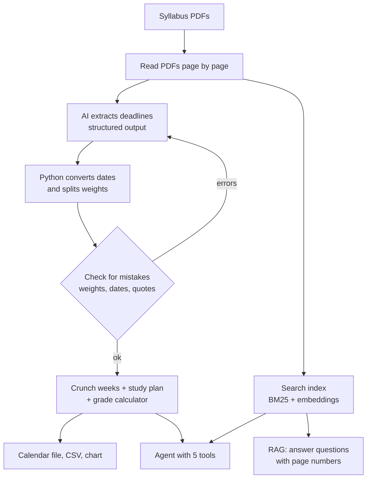

# Syllabus Planner

By Joel Biju

My hackathon project. You give it all your syllabi for the semester and it:
- pulls out every deadline and how much each one is worth
- checks the AI's work for mistakes
- shows which weeks have the most stuff due
- makes a study plan
- answers questions like "what do I need on the rest of chem to get an A-?"
- saves a calendar file you can import into Google Calendar

I made it because every syllabus is formatted differently and it's easy to miss that a few classes have big things due the same week. In the sample semester I tested it on, 59% of the grade across three classes is due in the same week (Oct 26-30).

Everything is in one file, `Syllabus_Planner.ipynb`. That includes the code, the sample syllabi, the answer key, the demo, and tests.

## Setup

**Google Colab (easiest):**
1. Go to colab.research.google.com, then File > Upload notebook, and pick `Syllabus_Planner.ipynb`
2. (Optional) Click the key icon on the left (Secrets), add `OPENAI_API_KEY` with your key, and turn on notebook access
3. Runtime > Run all

**On your own computer:**
```bash
pip install openai pydantic pypdf reportlab numpy pandas matplotlib jupyter
echo "OPENAI_API_KEY=sk-..." > .env    # optional
jupyter notebook Syllabus_Planner.ipynb
```
Then Run All.

It works without an API key too. In offline mode it uses saved extractions for the sample syllabi and keyword-only search, so you can still see everything. With a key it uses gpt-4o-mini by default (you can change it with the `OPENAI_MODEL` environment variable).

## Techniques used

| Technique | How I used it | Section |
|---|---|---|
| API calls | All the OpenAI calls go through one wrapper that retries on rate limits and gives readable errors | 2.1 |
| Structured output | The AI fills in a Pydantic schema (`CourseExtraction`) instead of returning text | 2.2, 2.4 |
| Prompt engineering | The extraction prompt has rules for how to record dates and quotes. If the AI makes a mistake, it gets a second prompt listing what was wrong | 2.4 |
| RAG | Questions are answered by searching the syllabi with BM25 + embeddings, and answers include page numbers | 2.6 |
| Agent | "Ask the Planner" uses function calling with 5 tools | 2.9 |

The main idea is that the AI only reads the syllabus and writes dates the way they're written ("Week 11, Tuesday"). Python turns them into real dates and does all the grade math, so the AI can't get the numbers wrong.

**Checking for mistakes:** the AI has to quote the syllabus for everything it pulls out. The code checks that each quote is actually in the PDF, that the grade weights add up to 100%, and that the dates are during the semester. If something fails, the errors get sent back to the AI to fix (up to 2 tries).

## Architecture



(There's also a picture version of this diagram at the top of the notebook.)

Basic flow:
1. Read the PDFs
2. AI extracts deadlines into the schema
3. Python converts the dates and splits up the weights
4. Check for mistakes (and send errors back to the AI if needed)
5. Find crunch weeks, make a study plan, export to calendar
6. Separately, the syllabi get indexed so you can ask questions (RAG) or use the agent

## What's in the notebook

- **Part 1:** setup (installs libraries, finds your API key)
- **Part 2:** all the code, split into sections 2.1 to 2.10
- **Part 3:** makes the 3 sample syllabi as PDFs, plus the saved extractions and my answer key
- **Part 4:** the demo (sections 4.1 to 4.11)
- **Part 5:** 13 tests that run without an API key:
  - 1-3: dates and weights match my answer key for each sample syllabus
  - 4: week-to-date math (Week 11 Tuesday = Oct 27)
  - 5-6: a real quote passes the quote check and a made-up one fails
  - 7-8: the fix-it loop sends errors back to the AI and ends with no errors (tested with a fake AI)
  - 9-10: the agent calls a tool and uses the result, and bad tool input gives an error instead of crashing
  - 11: the study plan never goes over 4 hours a day
  - 12: the grade calculator gives the right answer (90.5% for an A- in chem)
  - 13: the week of Oct 26 gets flagged as a crunch week

It also saves `semester.ics` (calendar), `study_plan.csv`, and `workload.png` to an `outputs` folder.

## Results

I labeled all 65 deadlines in the sample syllabi by hand and compared against a basic version that just searches for dates with regex:

| Class | Format | Deadlines | Regex found | Syllabus Planner found |
|---|---|---|---|---|
| CSC 316 | table + weekly quiz | 18 | 33% | 100% |
| HIST 207 | all paragraphs | 17 | 6% | 100% |
| CHEM 101 | mixed + a TBA item | 30 | 3% | 100% |

(In offline mode this is scoring the saved extractions. With an API key it scores what the AI actually returned.)

## Error handling

- Files that can't be read (missing, broken, or scanned images) get skipped with a message
- Missing or wrong API key gives a message saying what to fix
- Rate limits get retried
- If one syllabus fails the others still run
- Agent tools return an error message to the AI instead of crashing

## Limitations

- Scanned PDFs don't work since there's no text to read
- If a syllabus doesn't say when the semester starts, it assumes Aug 17, 2026 (you can change `TERM_START`)
- Things I'd add next: pulling syllabi straight from Canvas, a simple web app, and reminders before crunch weeks

## Team

| Member | What I did |
|---|---|
| Joel Biju | Everything (solo project): idea, extraction and checking, RAG, agent, study planner, testing, notebook, README, video |

The sample syllabi are made up for testing.
